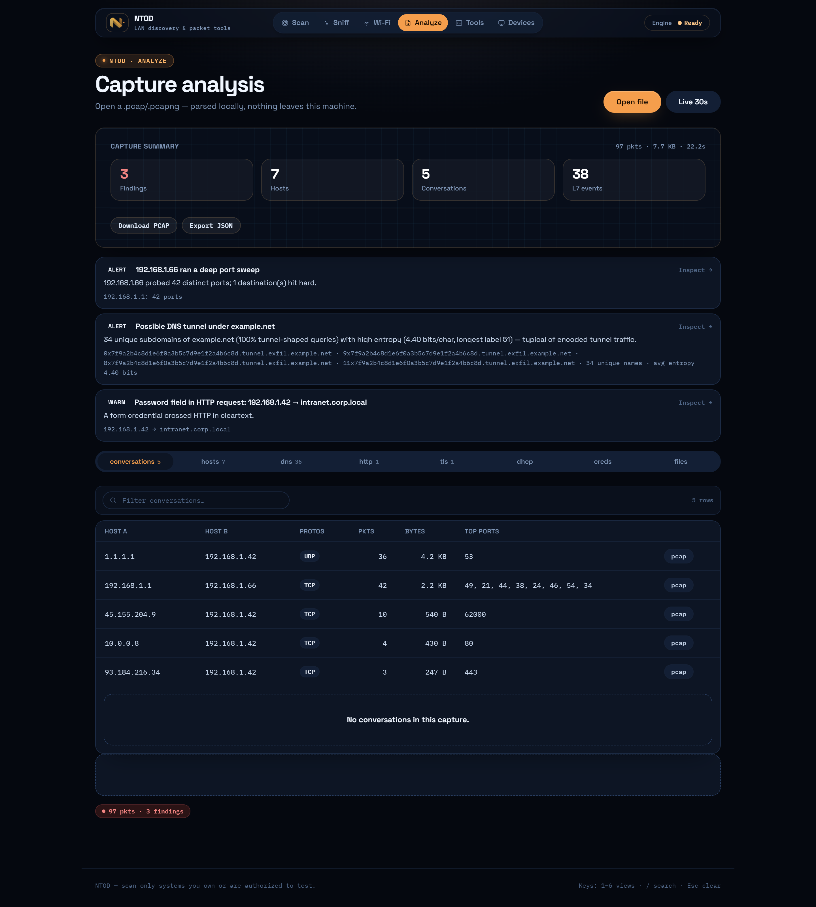
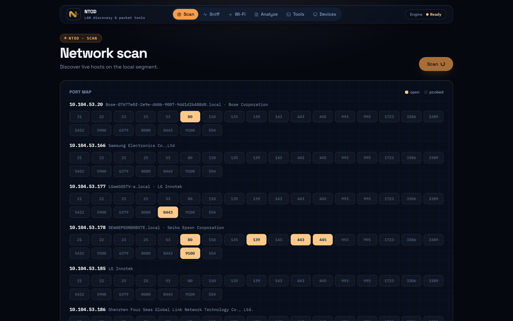
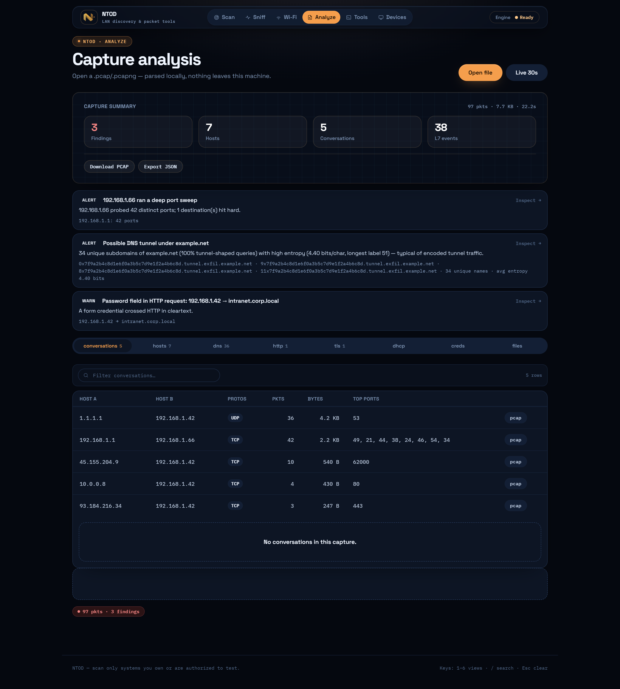
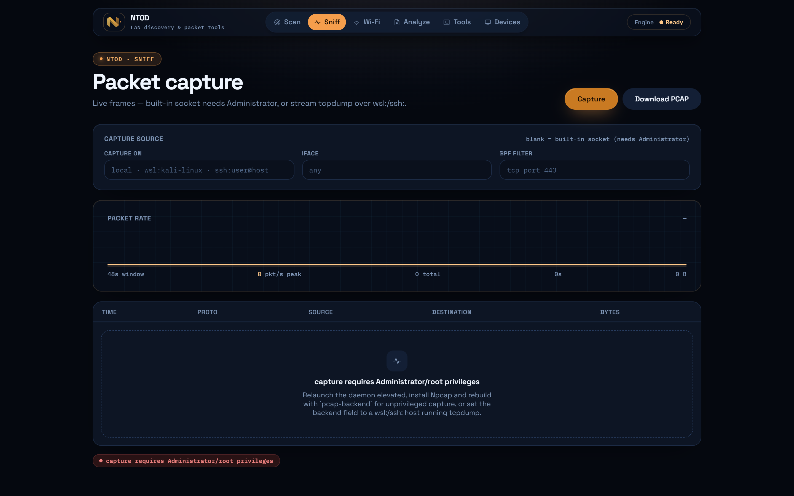
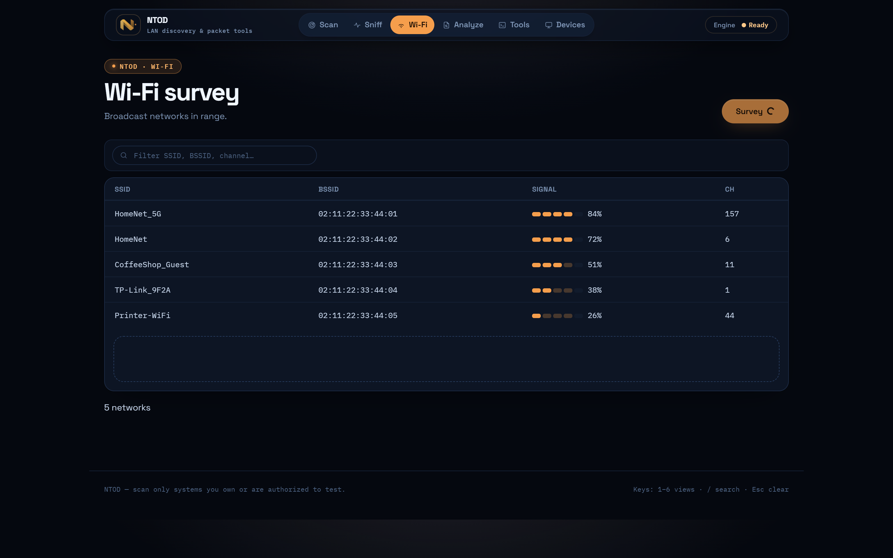
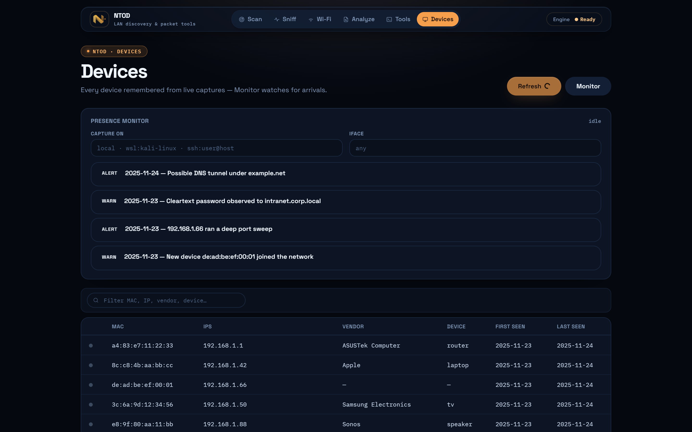
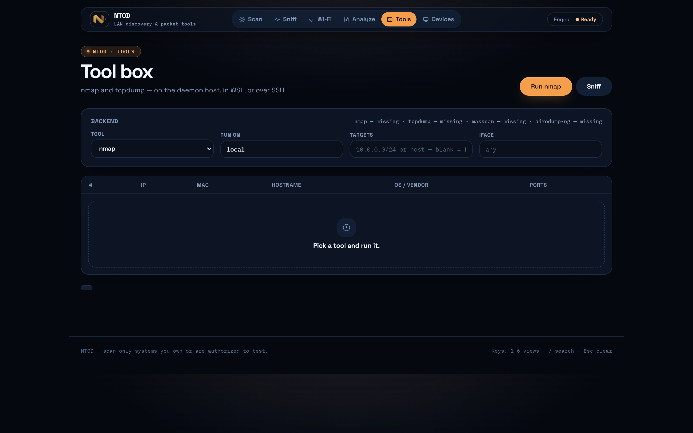

<p align="center">
  
</p>

<h1 align="center">ntod-scan</h1>

<p align="center">
  <strong>LAN discovery &amp; packet tools — local-first, zero telemetry, one binary.</strong><br/>
  The capture-analysis layer that cloud pcap sites sell, running entirely on your own machine.<br/>
  <em>Discover. Observe. Understand.</em>
</p>

<p align="center">
  
  
  
</p>

<p align="center">
  
</p>

> **Legal:** scan only networks you own or are explicitly permitted to test.
> See [SECURITY.md](SECURITY.md) for the full responsible-use policy.

---

## What it is

`ntod` is a single Rust binary — and a Rust workspace of reusable crates — that
covers the whole "what is on my network and what is it saying" workflow:

| Tier it replaces | ntod feature |
|---|---|
| Fing / Angry IP Scanner | `ntod scan` — live hosts, MAC/OUI vendor, hostnames, open ports |
| tcpdump / Wireshark-lite | `ntod sniff` — bounded live packet capture and decode |
| Kismet-lite | `ntod wifi` — nearby SSIDs, BSSID, signal, channel, security |
| WebPCAP / A-Packets / ScanSuite | `ntod analyze` — full pcap triage report, **on-device** |
| Fiddler-lite | `ntod proxy` — explicit HTTP/CONNECT proxy with byte accounting |
| nmap / masscan / tcpdump / airodump-ng | `ntod tool` — wrapped adapters, locally, in WSL, or over SSH |
| — | `ntod serve` — daemon with REST API, WebSocket stream, and a server-rendered web UI |

Everything is **local-first**: no accounts, no telemetry, no required calls to any
upstream service. Optional seams (AI summarization, external tools, ARP control)
are feature-gated and degrade to warnings — a scan never fails because an
optional piece is missing.

## Why it's different

- **The analyzer is the product.** `ntod analyze` produces the same class of
  report the hosted pcap sites do — bidirectional flows, L7 dissectors (DNS,
  HTTP, TLS + JA3, DHCP), credential extraction, and deterministic detectors
  (port-scan, DNS-tunnel, ARP-spoof, beaconing, TLS cert hygiene) — but the
  capture never leaves your disk.
- **Bounded everything.** Capture feeds, worker counts, timeouts, body sizes,
  report caps, in-memory stores — every queue and buffer has a hard limit. A
  hostile or malformed capture cannot pin unbounded memory.
- **One engine, three front ends.** The same analysis library powers the CLI,
  the upload endpoint, live captures, and remote captures over SSH — one report
  model everywhere.
- **No-JS-hydration web UI.** Server-rendered maud pages, htmx partials, SSE
  streams, self-hosted fonts, and a single build-step Svelte island. The UI
  works offline end-to-end.

## The web UI

One `ntod serve` process renders the whole console — six views over REST,
htmx partials, and SSE streams:

<p align="center">
  <br/>
  <em>Scan — live host discovery with a per-host port map, streamed in over SSE.</em>
</p>

<table>
  <tr>
    <td width="50%"></td>
    <td width="50%"></td>
  </tr>
  <tr>
    <td align="center"><em>Analyze — findings, flows, L7 tabs, per-flow pcap export.</em></td>
    <td align="center"><em>Sniff — bounded live capture, packet-rate wave, pcap export.</em></td>
  </tr>
  <tr>
    <td></td>
    <td></td>
  </tr>
  <tr>
    <td align="center"><em>Wi-Fi — broadcast networks in range, signal and channel.</em></td>
    <td align="center"><em>Devices — device memory and the cross-capture alert feed.</em></td>
  </tr>
  <tr>
    <td></td>
    <td></td>
  </tr>
  <tr>
    <td align="center"><em>Tools — nmap, masscan, tcpdump, airodump-ng via local, WSL, or SSH backends.</em></td>
    <td></td>
  </tr>
</table>

## Quick start

```sh
# Build (stable Rust, edition 2024)
cargo build --release -p ntod-cli

# Discover who's on the LAN
ntod scan                      # or: --subnet 192.168.1.0/24 --fast

# Triaged pcap report — the flagship (try it on the bundled demo capture)
ntod analyze examples/demo.pcap --json
ntod analyze capture.pcap --carve ./objects   # extract HTTP objects

# Live capture (needs Administrator/root)
ntod sniff --count 100

# The web UI + API daemon
ntod serve --port 7878         # → http://127.0.0.1:7878
```

Optional backends (WSL or SSH) let the `tools` adapters run against a Kali
box or a Linux capture host:

```sh
ntod tool nmap 10.0.0.0/24 --top-ports 500 --via ssh:user@kali
ntod tool sniff --iface wlan0mon --seconds 30 --via wsl --save out.pcap
```

## Running locally

The binary is `ntod` (crate `ntod-cli`). Three ways to run it:

```sh
cargo run -p ntod-cli -- serve --port 7878   # dev: no install
cargo install --path crates/cli             # puts `ntod` on PATH (~/.cargo/bin)
.\target\release\ntod.exe serve             # or invoke the built binary directly
```

### The web app (`ntod serve`)

```sh
# One-time, before cargo build: generate the Svelte island into apps/web
cd apps/islands && npm ci && npm run build && cd ../..

ntod serve                      # → http://127.0.0.1:7878
ntod serve --port 8080
```

- One daemon serves everything: server-rendered UI (`/`), REST (`/api/*`),
  WebSocket (`/ws`), htmx partials (`/partials/*`), SSE (`/sse/*`).
- `apps/web` is baked into the binary at compile time, so `serve` works from
  any directory — but build the islands **before** `cargo build` or the
  embedded copy lacks them. Skipping islands only loses the sniff view's
  live packet-rate widget.
- For frontend iteration, `--web-root apps/web` (the default) serves the
  on-disk copy when found in an ancestor directory, so CSS/JS edits need no
  rebuild.
- Screenshots in `docs/screenshots/` regenerate against a running daemon with
  `node scripts/capture-shots.mjs` (drives the installed Edge via
  `puppeteer-core`; see the script header).

### Privileges & data

| Command | Needs |
|---|---|
| `scan`, `analyze`, `serve`, `wifi` | nothing special |
| `sniff` | Administrator/root (raw sockets) — or Npcap via the `pcap-backend` build feature |
| `cut` | admin + Npcap SDK to build |

State (device history, baselines) lives in `$NTOD_DATA_DIR` or `~/.ntod-scan`;
only *live* captures write to it — uploaded pcaps never touch local history.
`RUST_LOG=debug` for verbose logs.

## Feature flags

`ntod-cli` builds lean by default; extras are opt-in cargo features:

| Feature | Unlocks | Needs |
|---|---|---|
| `ai` | `/api/ai/*`, natural-language filter & report summaries | Ollama endpoint |
| `tools` | `ntod tool *`, `/api/tools/*` | nmap / masscan / tcpdump / airodump-ng on the backend |
| `cut` | `ntod cut`, `ntod throttle` (ARP control, own networks only) | Npcap SDK (Windows) |
| `all` | everything above | — |

```sh
cargo build --release -p ntod-cli --features tools
```

## Architecture at a glance

```
┌────────────────────────────────────────────────────────┐
│ Shells        ntod (CLI)   Web UI (maud+htmx+SSE)      │
├────────────────────────────────────────────────────────┤
│ Seam          ntod-api — axum /api/*, /ws, /partials/* │
├──────────┬─────────────┬──────────────┬────────────────┤
│ ntod-    │ ntod-       │ ntod-        │ ntod-tools     │
│ core     │ capture     │ analysis     │ ntod-ai        │
│ scan/    │ pcap + raw  │ flows · L7   │ ntod-proxy     │
│ wifi/arp │ socket      │ detectors    │ ntod-control   │
└──────────┴─────────────┴──────────────┴────────────────┘
```

Full details — data flows, bounds, concurrency model, wire protocols — in
[docs/ARCHITECTURE.md](docs/ARCHITECTURE.md).

## Repository layout

```
crates/
  core/      scanning engine: scan, discover, wifi, arp, oui
  capture/   packet capture + pcap/pcapng read (pcapr) & write (pcapw)
  analysis/  pcap triage: flows, L7 dissectors, detectors, history
  api/       axum HTTP + WS seam and the server-rendered web UI
  cli/       the `ntod` binary (clap)
  ai/        optional AI seam       control/  optional ARP control
  proxy/     optional HTTP(S) proxy tools/    external-tool adapters
apps/
  web/       static assets — vendored app.css, ntod.css, ntod.js,
             fonts, htmx vendor, generated islands
  islands/   Svelte source for the one JS island (vite build)
docs/        BRD · PRD · SDD · TSD · ARCHITECTURE · screenshots
examples/    demo.pcap — synthetic capture exercising every detector
scripts/     gen-demo-pcap.py · capture-shots.mjs (README screenshots)
```

## Documentation

| Doc | Audience |
|---|---|
| [docs/BRD.md](docs/BRD.md) | Business case, stakeholders, KPIs |
| [docs/PRD.md](docs/PRD.md) | Product vision, user stories, acceptance criteria |
| [docs/ARCHITECTURE.md](docs/ARCHITECTURE.md) | System design, data flows, bounds |
| [docs/SDD.md](docs/SDD.md) | Component design, data models, state |
| [docs/TSD.md](docs/TSD.md) | API specs, wire protocols, build/test guide |
| [BRAND.md](BRAND.md) | Brand identity — Obsidian Ember palette, mark, voice |
| [DESIGN.md](DESIGN.md) | Design system (shared with ntok-scan) |
| [CONTRIBUTING.md](CONTRIBUTING.md) | Conventions, tests, layout rules |

## Verify

```sh
cargo fmt --all
cargo clippy --workspace -- -D warnings
cargo test --workspace
```

## Security

- Local-first by construction: no telemetry, no accounts.
- Remote-provided strings (SSIDs, hostnames) are treated as untrusted and
  escaped before reaching `innerHTML`.
- Report vulnerabilities privately per [SECURITY.md](SECURITY.md).

## License

MIT OR Apache-2.0 — see [LICENSE-MIT](LICENSE-MIT), [LICENSE-APACHE](LICENSE-APACHE).
